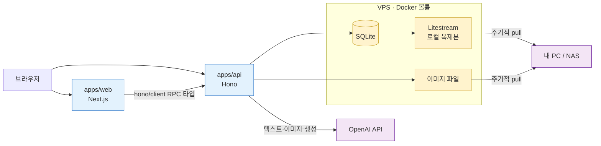

# novelist v1 결정 사항

2026-10-30 아젠다 세션(`/forge:fg-agenda`)에서 사용자가 내린 v1 착수 결정을 모은 문서입니다. 기획·작업 분해의 입력으로 씁니다. 되돌리기 어려운 결정 3건은 ADR로 따로 남겼고, 도메인 용어는 [`.forge/CONTEXT.md`](../.forge/CONTEXT.md)에 정리되어 있습니다.

괄호 안의 "추천안"은 세션에서 제시된 추천과 다르게 결정된 경우를 표시한 것입니다.

## 서비스 성격

- 대중 서비스가 아닌 **승인제 소규모 회원 서비스**. 누구나 가입을 신청할 수 있고, 관리자가 승인해야 사용할 수 있다. (추천안: 초대 코드)
- 회원이 여러 명이고, 회원마다 개인 공간이 있다. 회원별 공간이란 회원이 제목이 다른 소설을 여러 편 쓰는 것을 뜻하며, 별도의 작업공간 단위는 없다.
- 데이터는 회원별로 분리된다. 다른 회원의 소설은 볼 수 없다.
- v1 기능 축은 AI 소설 쓰기, 삽화 생성, 메모 세 가지다.

## 계정·인증·관리자

- users 테이블 + 이메일(로그인 ID)·비밀번호(해시) 로그인. (추천안: 환경변수 비밀번호)
- 계정은 웹 회원가입 화면에서 만든다.
- 첫 관리자 계정은 환경변수나 시드로 만든다. 웹에는 관리자를 만드는 경로가 없다.
- 메일은 보내지 않는다. 비밀번호를 잊으면 관리자가 초기화한다.
- 관리자 기능: 가입 승인, 회원 정지, 비밀번호 초기화, 회원 삭제, 사용량 조회.
- 회원을 삭제하면 소설·챕터·메모·삽화 파일까지 즉시 영구 삭제한다. 삭제 전에 확인 절차를 거친다. 되돌릴 수 있는 조치가 필요하면 회원 정지를 쓴다.
- 사용량 조회를 위해 AI·이미지 호출 기록을 남긴다.

회원은 가입을 신청한 뒤 관리자 승인을 거쳐야 활성 상태가 됩니다. 활성 회원은 정지되었다가 다시 풀릴 수 있고, 삭제는 데이터와 함께 즉시 영구 처리됩니다.

```mermaid
stateDiagram-v2
    [*] --> 승인대기: 회원가입 신청
    승인대기 --> 활성: 관리자 승인
    활성 --> 정지: 관리자 정지
    정지 --> 활성: 관리자 정지 해제
    활성 --> 삭제됨: 관리자 삭제(확인 절차)
    정지 --> 삭제됨: 관리자 삭제(확인 절차)
    삭제됨 --> [*]

    classDef wait fill:#fff3cd,stroke:#c9a227
    classDef ok fill:#d4edda,stroke:#2e7d32
    classDef stop fill:#f8d7da,stroke:#c62828
    class 승인대기 wait
    class 활성 ok
    class 정지,삭제됨 stop
```

## 글쓰기

- 본문 에디터는 TipTap 리치 텍스트이고, 서식은 문단·강조·장면 전환선만 쓴다. 본문은 ProseMirror JSON으로 저장한다. → [ADR 261030-004647](../.forge/adr/261030-004647-tiptap-json-body.md)
- 수정 이력: AI 초안을 수락하기 직전에 자동으로, 그리고 회원이 원할 때 수동으로 챕터 스냅샷을 남기고, 스냅샷으로 복원할 수 있다. 버전 비교 화면은 없다.
- 읽기 화면은 본인용 리더 뷰만 있다. 공개 발행은 없다.
- 내보내기: 소설 단위로 txt·마크다운 파일을 받을 수 있다.
- 모바일에서는 읽기와 메모까지 지원한다. 글쓰기와 AI 기능은 데스크톱 중심이다.

## 메모·주석·캐릭터

- 메모는 네 종류를 모두 v1에 넣는다. 소설에 붙는 메모, 챕터에 붙는 메모, 어느 소설에도 속하지 않는 자유 메모, 본문 주석이다. (추천안: 본문 주석 제외)
- AI는 회원이 "AI 참고"로 표시한 메모만 컨텍스트로 읽는다.
- 본문 주석은 TipTap 마크로 구현해서 본문을 수정해도 텍스트를 따라간다. 주석이 걸린 텍스트가 통째로 지워지면 주석은 '위치 잃은 주석'으로 보존한다.
- 세계관 등 일반 설정은 AI 참고 메모로 다룬다. 캐릭터만 소설별 항목으로 따로 둔다. 캐릭터 항목에는 이름, 참조 이미지, 외형 묘사가 들어간다. → [ADR 261030-004034](../.forge/adr/261030-004034-characters-separate-from-memos.md)

## AI 텍스트

- 기능: 이어쓰기, 다시쓰기, 다음 전개 제안, 요약(회원용).
- AI 초안은 스트리밍으로 보여 주고, 회원이 수락·거절·재생성한다.
- 제공자는 OpenAI 하나로 고정한다. (추천안: Claude 고정. 추천자가 Claude라서 이해충돌이 있음을 밝혔다)
- 컨텍스트는 요약 방식 하나로 구성한다. 직전 본문, 이전 챕터 요약, AI 참고 메모, 그 소설의 캐릭터 항목 전체가 들어간다.
- 챕터 요약은 챕터를 저장할 때 자동으로 생성·갱신한다. 회원용 요약 기능도 같은 요약을 보여 준다.

AI 텍스트 생성은 아래 순서로 진행됩니다.

```
회원이 기능 선택 → 컨텍스트 조립(직전 본문 + 챕터 요약 + AI 참고 메모 + 캐릭터) → OpenAI 스트리밍 → AI 초안 표시
                                                                                          ↓
                                                    수락(직전 스냅샷 저장 후 본문 반영) / 거절 / 재생성
```

## 삽화

- 회원이 장면 본문을 고르면 AI가 이미지 프롬프트 초안을 만들고, 회원이 고친 뒤 생성한다. 프롬프트를 직접 입력할 수도 있다.
- 외형 일관성은 강하게 유지한다. 캐릭터의 참조 이미지를 입력으로 넣어 매번 같은 모습으로 그린다. (추천안: 약한 일관성)
- 등장 캐릭터는 AI가 본문에서 자동으로 고르고, 회원이 바꿀 수 있다.
- 제공자는 OpenAI 이미지(GPT Image 계열)이고, 텍스트와 같은 키를 쓴다. 참조 이미지로 일관성이 얼마나 잘 유지되는지는 평가로 확인해야 한다.
- 이미지 파일은 Docker 볼륨 파일시스템에 저장하고, DB에는 경로와 메타데이터만 넣는다.

삽화는 아래 순서로 생성됩니다.

```
장면 선택 → AI가 프롬프트 초안·등장 캐릭터 제안 → 회원 수정 → 참조 이미지와 함께 OpenAI 이미지 생성 → 볼륨에 저장
```

## 비용

- 운영자 API 키 하나를 서버에 두고 모든 회원이 함께 쓴다.
- 회원별 사용량 한도는 없다. 비정상적인 사용은 관리자가 사용량을 조회한 뒤 정지로 대응한다. (추천안: 회원별 하루 한도)

## 아키텍처·운영

- 앱 구조: apps/web(Next.js)과 apps/api(Hono, TypeScript)를 분리한다. SQLite 쓰기는 API 서버 한 프로세스만 맡는다. → [ADR 261030-005014](../.forge/adr/261030-005014-separate-web-and-api.md) (추천안: Next.js 단일 앱)
- API 타입은 hono/client RPC로 web과 공유한다.
- DB는 SQLite다.
- 배포는 VPS + Docker이고, SQLite 파일과 이미지는 영구 볼륨에 둔다.
- 백업: Litestream으로 VPS 안에 SQLite 로컬 복제본을 만들고, 그 복제본과 이미지 디렉터리를 VPS 밖의 내 PC나 NAS가 주기적으로 끌어온다. 객체 스토리지는 쓰지 않는다.

브라우저는 Next.js 웹과 Hono API에 접속합니다. 데이터에 손대는 일과 AI 호출은 모두 API 서버가 처리하고, 볼륨에 든 데이터는 VPS 밖으로 백업됩니다.



## 팀 역할

- 삽화는 역할 두 개가 나눠 맡는다. ai 역할은 프롬프트 초안, 등장 캐릭터 선택, OpenAI 이미지 어댑터, 참조 이미지 입력을 맡고, backend는 이미지 저장과 API를 맡는다. 새 역할은 두지 않는다.
- `.agents/team.json`의 역할 메모를 이 문서의 결정에 맞춰 고친다. 수정안은 사용자에게 먼저 보여 주고 적용한다.

## 범위 밖 (v1)

- 공개 발행, 회원 간 공유, 외부 공개 링크 — v1은 본인용 읽기 화면만 둔다.
- 버전 비교(diff) 화면 — v1은 스냅샷 복원만 지원한다.
- epub 내보내기 — v1은 txt·마크다운만 지원한다.
- 모바일 글쓰기·AI 기능 최적화 — v1 모바일은 읽기·메모까지.
- 회원별 API 키 입력(BYOK), 회원별 사용량 한도 — 운영자 키를 공유하고 한도는 두지 않는다.
- 메일 발송(셀프 비밀번호 재설정, 가입 알림 등) — 관리자 초기화로 대신한다.
- 결제·구독·수익화.
- PostgreSQL 등 별도 DB 서버 — SQLite를 쓴다.
- 댓글·좋아요 등 독자 커뮤니티 기능.
