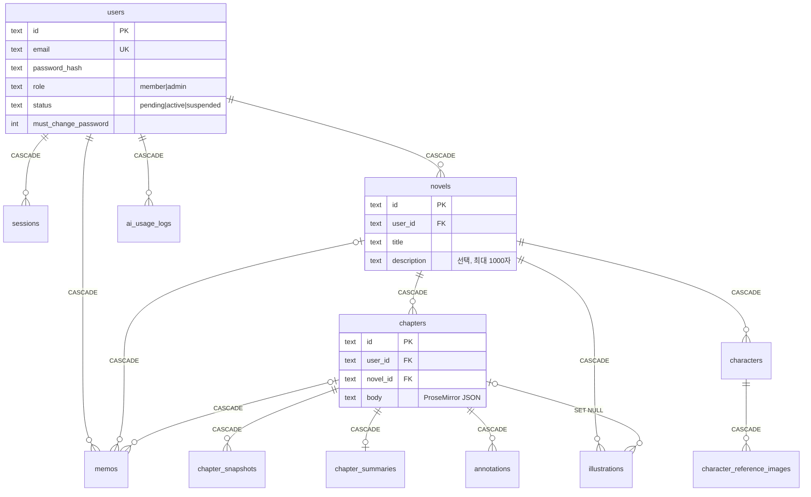

# v1 데이터 모델 (ERD)

v1 전체 엔티티 12개의 설계 문서입니다. 1/7 단계에서는 테이블을 만들지 않고, 각 부분 계획이 자기 몫의 테이블을 `src/schema.ts`와 마이그레이션으로 추가합니다. 이 문서는 그때 기준이 되는 설계도입니다.

## 설계 원칙

- **소유자 컬럼**: 회원 소유 데이터(`users`, `sessions` 제외)는 모두 `user_id`를 직접 가진다. 부모를 거치지 않고도 `WHERE user_id = ?` 한 번으로 본인 데이터만 조회·검증할 수 있게 하기 위함이다(회원별 데이터 분리).
- **삭제 전파**: 회원 삭제는 `users` 행 하나를 지우면 `ON DELETE CASCADE`로 모든 하위 행이 함께 지워진다. SQLite는 연결마다 `PRAGMA foreign_keys = ON`이어야 동작하며, `packages/db`의 연결 헬퍼가 이를 강제한다.
- **이미지 파일**: DB에는 경로와 메타데이터만 둔다. 디스크의 파일(참조 이미지, 삽화)은 CASCADE로 지워지지 않으므로 **애플리케이션 레벨에서 삭제**한다. 회원 삭제 시 순서는 파일 경로 수집 → 파일 삭제 → `users` 행 삭제이다.
- **ID**: 텍스트 ID(UUID/ULID)를 쓰고, 시각은 epoch 밀리초 정수로 저장한다.
- **챕터 본문**: ProseMirror JSON(TipTap)을 텍스트 컬럼에 저장한다. 서식은 문단·강조·장면 전환선만 쓴다.

회원 삭제 시 아래 순서로 처리합니다.

```
파일 경로 수집(참조 이미지·삽화) → 디스크 파일 삭제 → users 행 삭제 → DB CASCADE로 나머지 전부 삭제
```

## 관계도

회원 한 명을 뿌리로 모든 데이터가 `ON DELETE CASCADE`로 이어집니다. 점선은 소유 관계가 아닌 참조이며 `SET NULL`로 처리합니다.



## 엔티티

`user_id`는 모두 `users.id`를 참조하며 `ON DELETE CASCADE`입니다.

### users — 회원

| 컬럼                        | 설명                                                    |
| --------------------------- | ------------------------------------------------------- |
| `id` PK                     |                                                         |
| `email` UNIQUE              | 로그인 ID (소문자 정규화)                               |
| `password_hash`             | scrypt 해시(`scrypt$salt$hash`) |
| `role`                      | `member` \| `admin`. 첫 관리자는 환경변수/시드로만 생성 |
| `status`                    | `pending`(승인 대기) \| `active` \| `suspended`(정지)   |
| `must_change_password`       | 0/1. 관리자 초기화 직후 1 — 새 비밀번호를 정하기 전에는 비밀번호 변경·내 정보·로그아웃만 가능 |
| `created_at`, `approved_at` |                                                         |

상태 전이: `pending → active ⇄ suspended`, 삭제는 모든 상태에서 즉시 영구 삭제. 가입 거절은 `pending` 행을 바로 삭제(`rejected` 상태 없음). 소유자 컬럼 없음(이 테이블이 뿌리).

### sessions — 로그인 세션

| 컬럼                       | 설명                                |
| -------------------------- | ----------------------------------- |
| `id` PK                    | 세션 토큰의 해시                    |
| `user_id` FK               | CASCADE. 정지·삭제 시 세션도 사라짐 |
| `expires_at`, `created_at` |                                     |

### novels — 소설

| 컬럼                       | 설명   |
| -------------------------- | ------ |
| `id` PK, `user_id` FK      | 소유자 |
| `title`                    |        |
| `description`              | 선택 입력(NULL 허용), 최대 1,000자(검증은 API) |
| `created_at`, `updated_at` |        |

회원 한 명이 여러 편을 가진다. 별도의 작업공간 단위는 없다.

### chapters — 챕터

| 컬럼                       | 설명                               |
| -------------------------- | ---------------------------------- |
| `id` PK, `user_id` FK      | 소유자                             |
| `novel_id` FK              | CASCADE                            |
| `title`, `position`        | 순서                               |
| `body`                     | **ProseMirror JSON** (TipTap 문서) |
| `created_at`               |                                    |
| `updated_at`               | 본문 저장 때만 갱신(저장 충돌 판정용). 제목 변경·순서 이동은 바꾸지 않는다 |

`position`은 소설 안에서의 순서이며 삭제로 빈 번호가 생길 수 있다(유일 제약 없음). 위/아래 이동은 인접 챕터와 `position`을 맞바꾸고, 새 챕터는 현재 최댓값 + 1이다.

### chapter_snapshots — 챕터 스냅샷(수정 이력)

AI 초안 수락 직전·복원 직전에 자동(`auto`), 회원 요청 시 수동(`manual`)으로 남긴다. 복원만 지원하며 비교(diff)는 없다. `auto`는 챕터당 최근 20개만 보관하고 `manual`은 지우지 않는다.

| 컬럼                  | 설명                        |
| --------------------- | --------------------------- |
| `id` PK, `user_id` FK | 소유자                      |
| `chapter_id` FK       | CASCADE                     |
| `body`                | 당시 본문(ProseMirror JSON) |
| `kind`                | `auto` \| `manual`          |
| `created_at`          |                             |

### chapter_summaries — 챕터 요약

챕터 저장 시 자동 생성·갱신된다. AI 컨텍스트와 회원용 요약 기능이 같은 행을 쓴다.

| 컬럼                | 설명                                      |
| ------------------- | ----------------------------------------- |
| `chapter_id` PK/FK  | CASCADE. 챕터당 1행                       |
| `user_id` FK        | 소유자                                    |
| `summary`           |                                           |
| `source_updated_at` | 요약 시점의 챕터 갱신 시각(낡았는지 판단) |

### memos — 메모

종류는 세 가지다. 본문에 붙는 주석은 별도 테이블(`annotations`)이다.

| 컬럼                       | 설명                                                            |
| -------------------------- | --------------------------------------------------------------- |
| `id` PK, `user_id` FK      | 소유자                                                          |
| `kind`                     | `novel`(소설 메모) \| `chapter`(챕터 메모) \| `free`(자유 메모) |
| `novel_id` FK NULL         | `novel`·`chapter`일 때 필수, CASCADE                            |
| `chapter_id` FK NULL       | `chapter`일 때 필수, CASCADE                                    |
| `body`                     |                                                                 |
| `ai_reference`             | 0/1. **AI 참고 메모** 플래그. 1인 메모만 AI 컨텍스트에 들어간다 |
| `created_at`, `updated_at` |                                                                 |

`kind`와 FK 널 여부의 일치는 CHECK 제약으로 보장한다.

### annotations — 본문 주석

TipTap 마크의 id로 본문과 연결된다. 본문을 고쳐도 마크가 텍스트를 따라간다.

| 컬럼                       | 설명                                           |
| -------------------------- | ---------------------------------------------- |
| `id` PK, `user_id` FK      | 소유자                                         |
| `chapter_id` FK            | CASCADE                                        |
| `mark_id`                  | 본문 마크의 id. 챕터 내 유일                   |
| `body`                     | 주석 내용                                      |
| `state`                    | `anchored` \| `orphaned`                       |
| `quote`                    | 걸려 있던 텍스트 스냅샷(위치 잃은 주석 표시용) |
| `created_at`, `updated_at` |                                                |

주석이 걸린 텍스트가 통째로 지워지면 챕터 저장 시 본문에서 해당 `mark_id`를 찾지 못하므로 행을 지우지 않고 `state = 'orphaned'`로 바꿔 보존한다.

### characters — 캐릭터

소설별 항목. 세계관 등 다른 설정은 AI 참고 메모로 다룬다.

| 컬럼                       | 설명      |
| -------------------------- | --------- |
| `id` PK, `user_id` FK      | 소유자    |
| `novel_id` FK              | CASCADE   |
| `name`                     |           |
| `appearance`               | 외형 묘사 |
| `created_at`, `updated_at` |           |

### character_reference_images — 캐릭터 참조 이미지

삽화 생성 시 입력으로 들어가 외형을 일관되게 유지한다.

| 컬럼                                   | 설명                                       |
| -------------------------------------- | ------------------------------------------ |
| `id` PK, `user_id` FK                  | 소유자                                     |
| `character_id` FK                      | CASCADE                                    |
| `file_path`                            | 볼륨 안 상대 경로. **파일 삭제는 앱 레벨** |
| `mime_type`, `byte_size`, `created_at` |                                            |

### illustrations — 삽화

| 컬럼                  | 설명                                                        |
| --------------------- | ----------------------------------------------------------- |
| `id` PK, `user_id` FK | 소유자                                                      |
| `novel_id` FK         | CASCADE                                                     |
| `chapter_id` FK NULL  | 장면이 속한 챕터. 챕터 삭제 시 SET NULL(삽화는 소설에 남김) |
| `scene_text`          | 장면 본문                                                   |
| `prompt`              | 최종 프롬프트(회원이 고친 것)                               |
| `character_ids`       | 등장 캐릭터 ID 목록(JSON)                                   |
| `file_path`           | 볼륨 안 상대 경로. **파일 삭제는 앱 레벨**                  |
| `created_at`          |                                                             |

### ai_usage_logs — AI·이미지 호출 기록

관리자 사용량 조회용. 회원별 한도는 없다.

| 컬럼                            | 설명                                                                             |
| ------------------------------- | -------------------------------------------------------------------------------- |
| `id` PK, `user_id` FK           | 소유자. 회원 삭제 시 CASCADE로 함께 삭제                                         |
| `kind`                          | `continue` \| `rewrite` \| `suggest` \| `summarize` \| `image_prompt` \| `image` |
| `model`                         |                                                                                  |
| `input_tokens`, `output_tokens` | 텍스트 호출                                                                      |
| `image_count`                   | 이미지 호출                                                                      |
| `created_at`                    |                                                                                  |

## CASCADE 경로 요약

`users`를 지우면 다음 경로로 전부 사라진다. 이미지 파일만 앱 레벨에서 먼저 지운다.

```
users ─┬─ sessions
       ├─ ai_usage_logs
       ├─ memos
       └─ novels ─┬─ chapters ─┬─ chapter_snapshots
                  │            ├─ chapter_summaries
                  │            └─ annotations
                  ├─ characters ── character_reference_images  (파일: 앱 레벨 삭제)
                  └─ illustrations                               (파일: 앱 레벨 삭제)
```

모든 회원 소유 테이블이 `user_id`를 직접 가지므로, 위 경로 외에도 `user_id` 자체의 CASCADE가 이중 안전장치가 된다.
